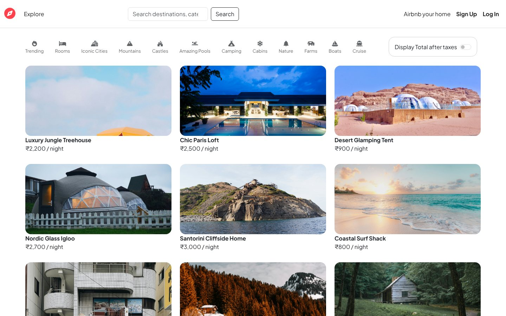
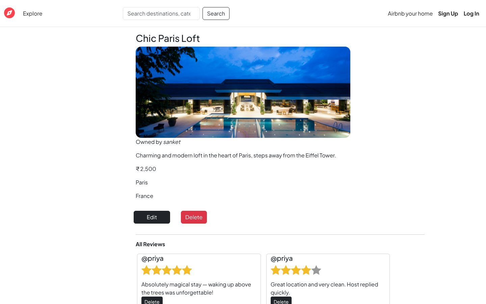
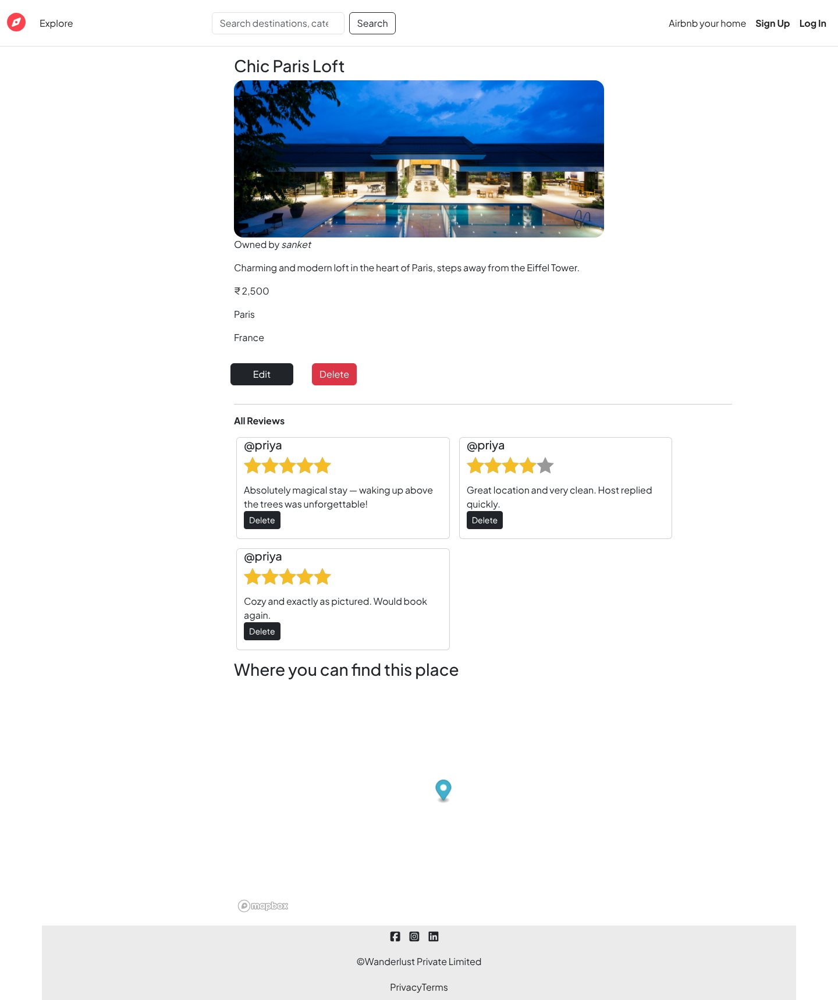
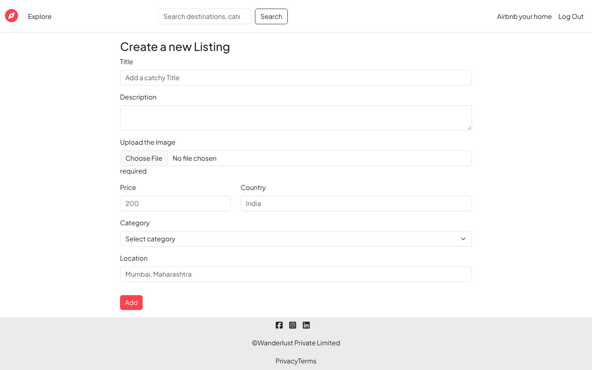
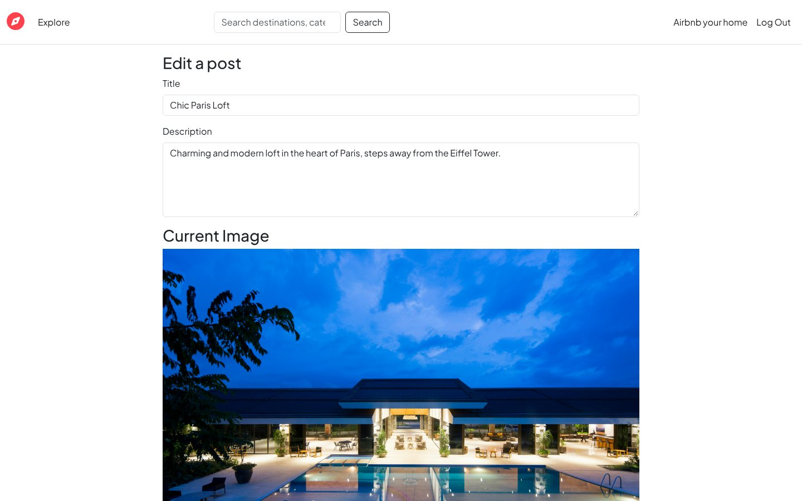
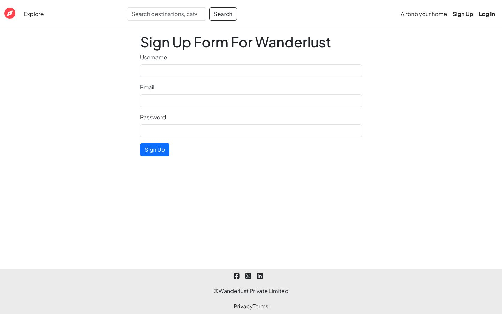
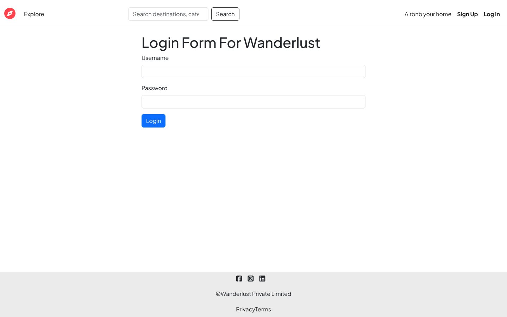
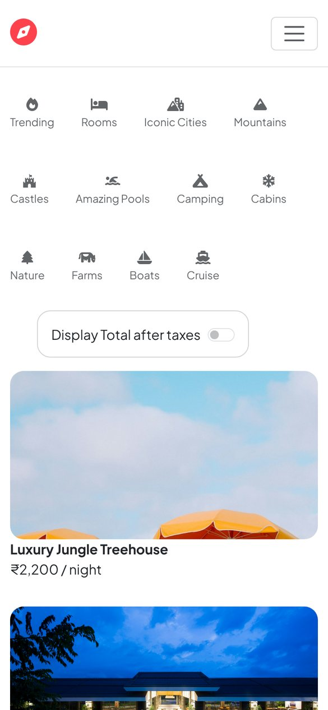

<div align="center">

# Wanderlust (v1)

**An Airbnb-style listings web app built with Node.js, Express, MongoDB and EJS — the first version of the project.**




</div>

> The actively developed version — with bookings, Razorpay payments, wishlist, messaging, an admin panel and AI features — is **[Wanderlust-master](https://github.com/Sanket1516/Wanderlust-master)**.

## Screenshots

> Real captures of the running app with the seed listings from `init/data.js`.

| Listing details | Listing page with reviews and map |
|:---:|:---:|
|  |  |
| **Create a listing** | **Edit a listing** |
|  |  |
| **Sign up** | **Log in** |
|  |  |

<p align="center"><br/><sub>Mobile</sub></p>

## Features

- **Listings CRUD** — create, view, edit and delete stays with title, description, price, location, country and category
- **Image upload** to Cloudinary through Multer
- **Maps** — locations geocoded with Mapbox and shown on the listing page
- **Categories** — Trending, Rooms, Iconic Cities, Mountains, Castles, Pools, Camping, Cabins, Nature, Farms, Boats, Cruise
- **Reviews** with 1–5 star ratings; only the author can delete a review
- **Authentication** with Passport Local (sign up, log in, log out); only the owner can edit or delete a listing
- **Validation** on the server with Joi and in the browser with Bootstrap form validation
- "Display total after taxes" toggle and search bar
- Central error handling with a custom `ExpressError` and `wrapAsync`

## Tech stack

Node.js · Express 5 · MongoDB + Mongoose · EJS + ejs-mate · Bootstrap 5 · Passport · Joi · Multer · Cloudinary · Mapbox

## Getting started

Requires Node.js 18+ and MongoDB running locally on `mongodb://127.0.0.1:27017`.

```bash
git clone https://github.com/Sanket1516/Wanderlust.git
cd Wanderlust
npm install
```

Create a `.env` file with your own keys:

```env
CLOUD_NAME=your_cloudinary_cloud_name
CLOUD_API_KEY=your_cloudinary_key
CLOUD_API_SECRET=your_cloudinary_secret
MAPBOX_TOKEN=your_mapbox_public_token
```

Seed sample listings (optional) and start the server:

```bash
node init/index.js      # loads init/data.js into the "vanderlust" database
node app.js             # http://localhost:8080/listings
```

## Project structure (MVC)

```
app.js            Express app, sessions, Passport, routes
routes/           listing.js, reviews.js, user.js
controller/       listings.js, reviews.js, users.js
models/           listing.js, review.js, user.js
views/            EJS pages (listings, users, includes, errors)
layouts/          boilerplate layout
public/           CSS and client JS (form validation, map)
middleware.js     isLoggedIn, isOwner, isReviewAuthor, validation
schema.js         Joi schemas
cloudConfig.js    Cloudinary storage
init/             seed data
```

## Author

**Sanket Mali** · [GitHub](https://github.com/Sanket1516)
